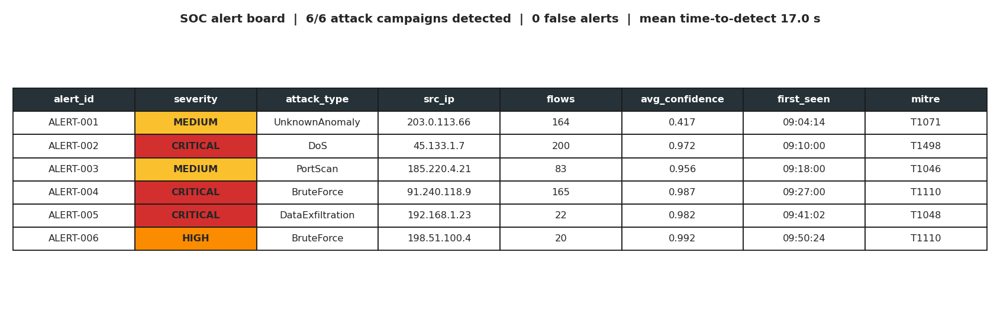
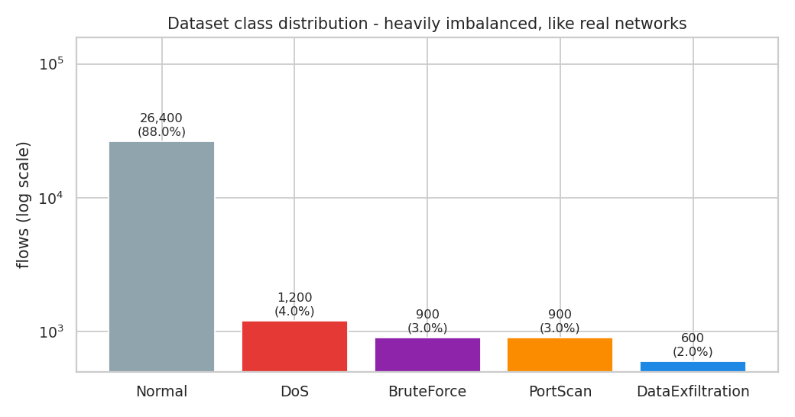
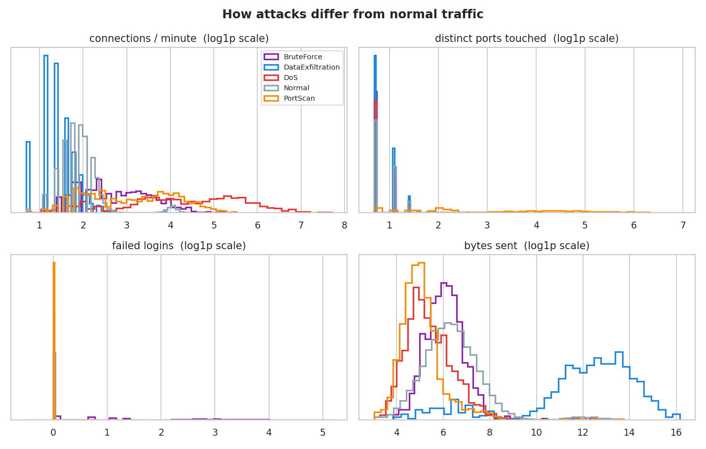
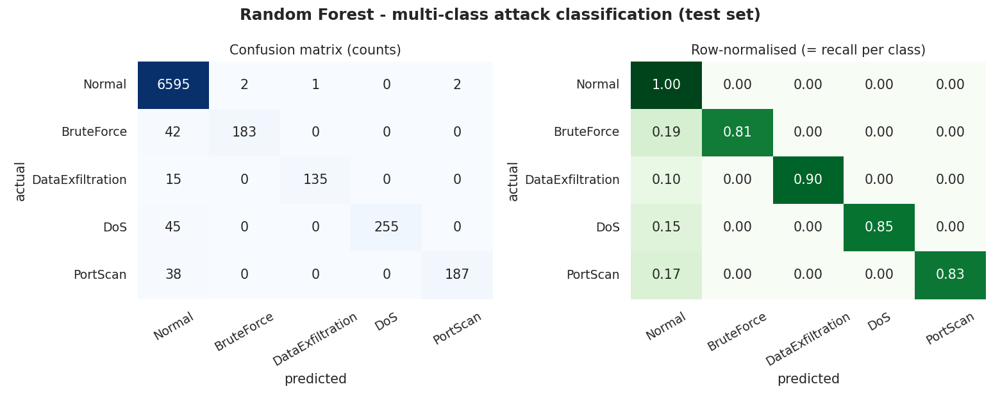
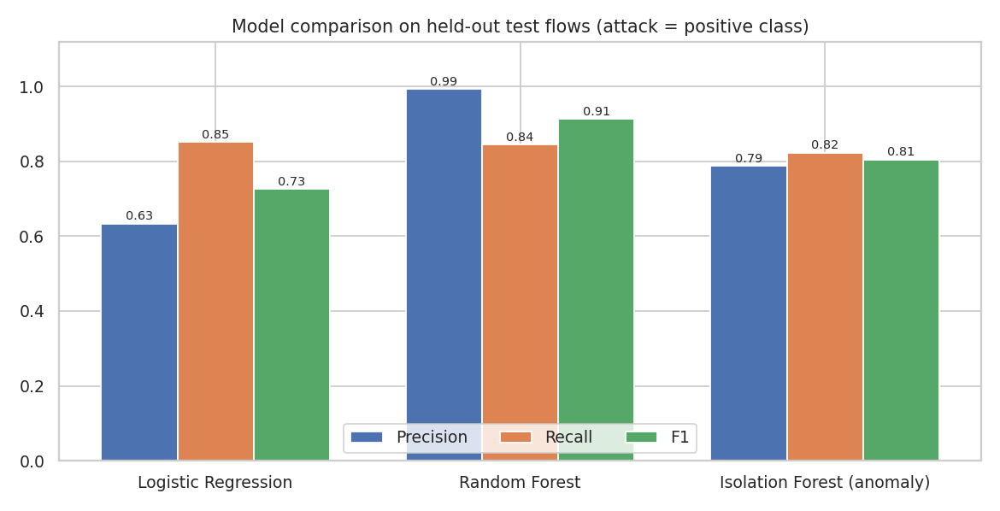
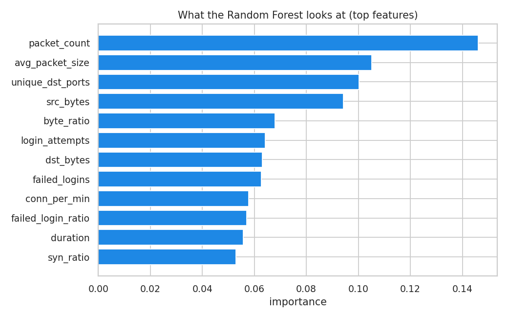
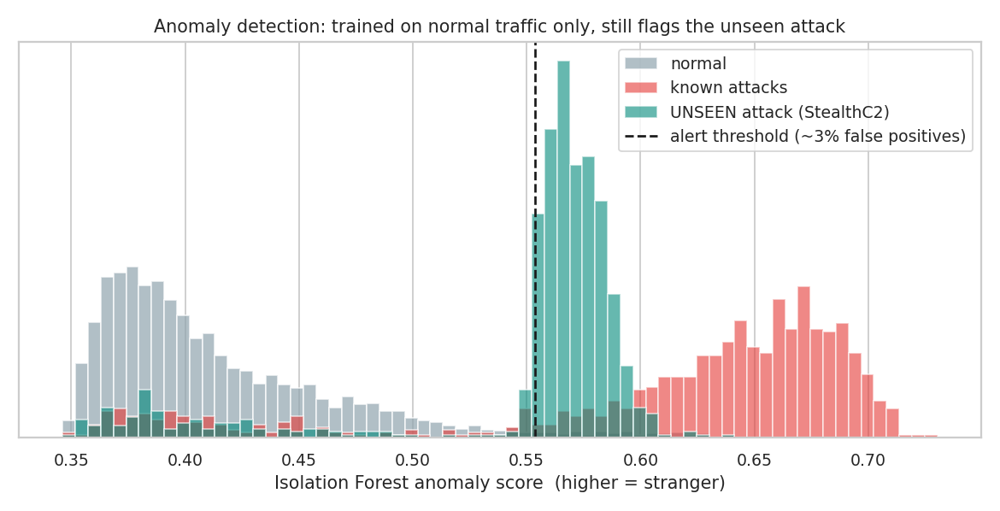
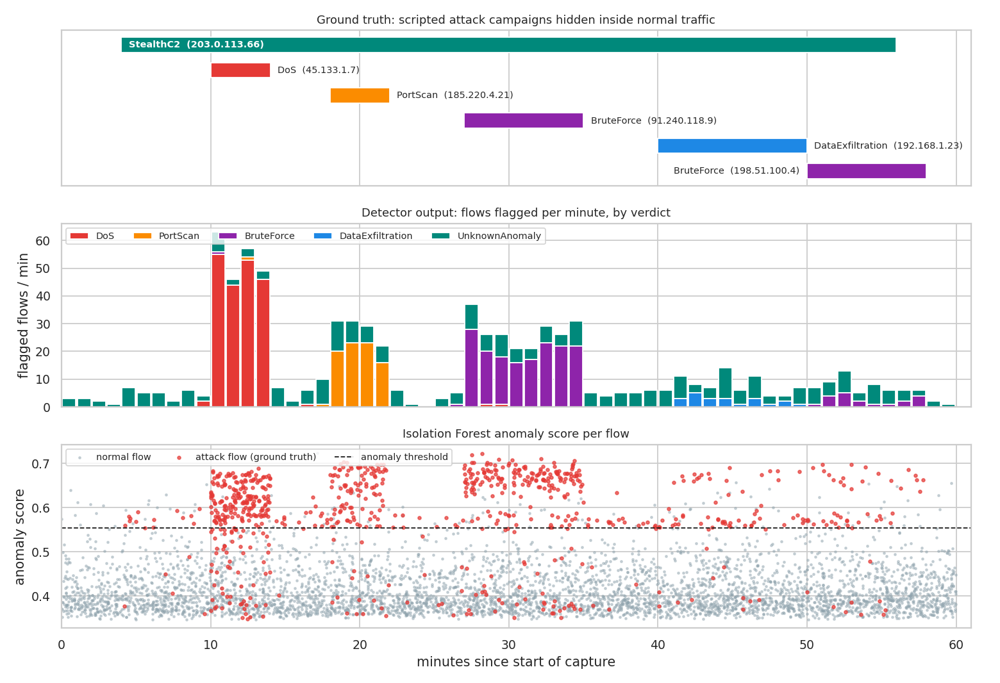
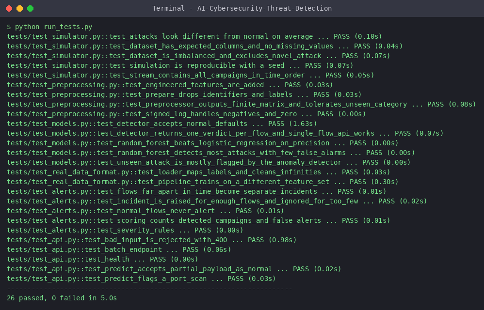
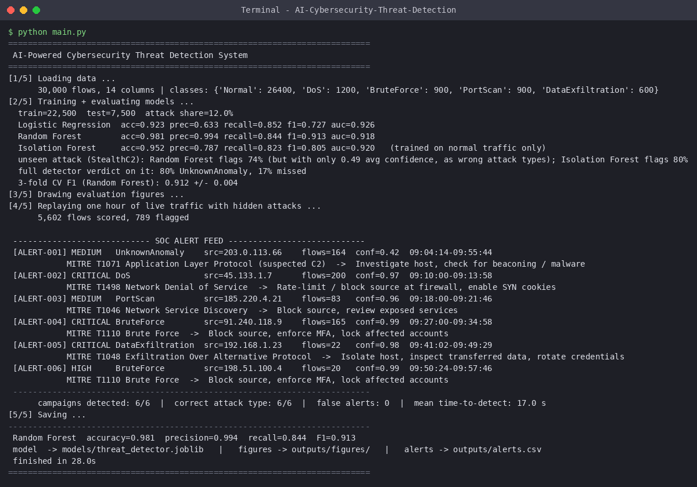

# 🛡️ AI-Powered Cybersecurity Threat Detection System

Machine-learning system that watches network traffic and raises **SOC-style alerts**: it classifies known attacks (DoS, port scan, brute force, data exfiltration) with Random Forest, flags **never-seen-before behaviour** with an Isolation Forest, groups suspicious flows into incidents with severity + MITRE ATT&CK mapping, and exposes everything through a REST API.



> **Data note:** there is no access to a real corporate network, so training and testing use a **built-in cyber-range simulator** that generates realistic flow records (including stealthy, low-and-slow and camouflaged attack traffic). The pipeline also runs on real datasets (CICIDS2017 / NSL-KDD / UNSW-NB15) - see [`docs/REAL_DATASETS.md`](docs/REAL_DATASETS.md). Numbers below are from simulated data.

## Results (simulated data, held-out test set)
| Model | Precision | Recall | F1 | False-positive rate |
|---|---|---|---|---|
| Logistic Regression | 0.63 | 0.85 | 0.73 | 6.7% |
| **Random Forest** (supervised) | **0.99** | 0.84 | **0.91** | 0.08% |
| Isolation Forest (trained on normal traffic only) | 0.79 | 0.82 | 0.81 | 3.0% |

3-fold cross-validated F1 for the Random Forest: **0.912 ± 0.004**.

**Live replay** - one hour of traffic (5,602 flows) with 6 hidden attack campaigns, scored flow by flow:
- ✅ **6 / 6 campaigns detected**, attack type correct for all 6, **0 false alerts**, mean time-to-detect **17 s**
- ✅ A **stealthy command-and-control channel the models were never trained on** was flagged as `UnknownAnomaly` (Isolation Forest flags 80% of its flows; the supervised model alone only half-recognises it, with low confidence, as the wrong attack types)

Why recall is "only" 0.84 per flow: ~15% of every attack's flows are deliberately camouflaged to look normal, and 40% of each attack is low-rate "stealth" traffic. That is exactly why flows are **aggregated into incidents** - a campaign is caught even when individual flows slip through.

## How it works
```
Network flows ─► Preprocessing ─► Random Forest ──────┐
 (simulated /    (clean, engineer,  (known attacks)    ├─► Verdict per flow ─► Incident builder ─► Alerts
  real CSV)       log-scale, scale)  Isolation Forest ─┘    Normal / DoS /       (group by source IP,    severity + MITRE
                                     (unknown anomalies)    PortScan / ... /      min flows, time gap)    + response advice
                                                            UnknownAnomaly
```
Details: [`docs/ARCHITECTURE.md`](docs/ARCHITECTURE.md)

| Attack | What the model sees | MITRE ATT&CK |
|---|---|---|
| DoS | huge connection rate, tiny payloads, SYN-heavy | T1498 |
| Port scan | many distinct ports touched, refused connections | T1046 |
| Brute force | many login attempts, most failing | T1110 |
| Data exfiltration | very large uploads, long flows, odd services / DNS | T1048 |
| Unknown / zero-day | statistically unlike normal traffic | T1071 (suspected C2) |

## Folder structure
```
AI-Cybersecurity-Threat-Detection/
├── main.py              # run everything: simulate → train → evaluate → replay attacks → alerts + figures
├── predict.py           # score hand-written sample flows with the trained model
├── explore.py           # dataset preview + preprocessing summary
├── run_tests.py         # run all tests (no pytest needed)
├── src/
│   ├── config.py        # all tunable values
│   ├── simulator.py     # cyber-range: normal + attack traffic, 1-hour attack replay
│   ├── data_loader.py   # simulator OR real CSV (CICIDS / NSL-KDD / UNSW)
│   ├── preprocessing.py # feature engineering + scaling (sklearn Pipeline)
│   ├── models.py        # Logistic Regression, Random Forest, Isolation Forest
│   ├── evaluate.py      # accuracy / precision / recall / F1 / ROC-AUC
│   ├── detector.py      # deployable ThreatDetector (supervised + anomaly)
│   ├── alerts.py        # incidents, severity, MITRE mapping, scoring vs ground truth
│   ├── api.py           # Flask REST API
│   ├── visualize.py     # all charts
│   └── pipeline.py      # train + evaluate orchestration
├── tests/               # 26 tests (simulator, preprocessing, models, alerts, API, real-data format)
├── data/sample/         # 500-row sample of the dataset
├── docs/                # architecture, real datasets, GitHub + resume + interview guide
├── screenshots/         # charts, terminal runs, code highlights (used below)
├── terminal_logs/       # raw text of every captured run
└── outputs/             # metrics.json, alerts.csv/json, figures (generated)
```

## Installation
Python 3.9+ · no GPU needed.

**Windows**
```bat
git clone https://github.com/<your-username>/AI-Cybersecurity-Threat-Detection.git
cd AI-Cybersecurity-Threat-Detection
python -m venv venv
venv\Scripts\activate
pip install -r requirements.txt
```
**Mac / Linux**
```bash
git clone https://github.com/<your-username>/AI-Cybersecurity-Threat-Detection.git
cd AI-Cybersecurity-Threat-Detection
python3 -m venv venv && source venv/bin/activate
pip install -r requirements.txt
```

## How to run
```bash
python explore.py            # look at the data + preprocessing
python main.py               # train, evaluate, replay attacks, write alerts + figures   (~30 s)
python predict.py            # try the trained model on sample flows
python -m src.api            # start the REST API on http://127.0.0.1:5000
python run_tests.py          # 26 tests (or: python -m pytest -q)
python main.py --data cicids.csv --label-col Label --no-replay     # real dataset
```
Test the API:
```bash
curl -X POST http://127.0.0.1:5000/predict -H "Content-Type: application/json" \
  -d '{"unique_dst_ports":150,"conn_per_min":60,"syn_ratio":0.5,"conn_state":"REJ","src_bytes":70,"dst_bytes":0,"duration":0.05}'
# {"anomalous":true,"attack_type":"PortScan","confidence":0.6011,"threat_detected":true,"verdict":"PortScan", ...}
```
Send only the fields you know; the rest default to a typical normal flow. Bad input returns HTTP 400.

## Screenshots
| Class imbalance | Attacks vs normal | Confusion matrix |
|---|---|---|
|  |  |  |

| Model comparison | Feature importance | Anomaly scores (unseen attack) |
|---|---|---|
|  |  |  |

**Live replay timeline** (what the attackers did → what the detector flagged → anomaly scores):


**Terminal proof (real runs, raw text in [`terminal_logs/`](terminal_logs))**
| Tests (26 passed) | Training + SOC alert feed |
|---|---|
|  |  |

More: [dataset + preprocessing](screenshots/terminal/02_dataset_and_preprocessing.png) · [sample predictions](screenshots/terminal/05_predict_samples.png) · [API requests](screenshots/terminal/06_api_requests.png) · [install check](screenshots/terminal/01_install_check.png)

**Code highlights:** [attack simulator](screenshots/code/01_attack_simulator.png) · [preprocessing pipeline](screenshots/code/02_preprocessing_pipeline.png) · [Isolation Forest](screenshots/code/03_isolation_forest.png) · [ThreatDetector](screenshots/code/04_threat_detector.png) · [alert generation](screenshots/code/05_alert_generation.png) · [Flask API](screenshots/code/06_flask_api.png) · [training + evaluation](screenshots/code/07_training_and_evaluation.png)

## Limitations (honest)
- Results come from a simulator - they show the pipeline works, **not** that it would hit these numbers on a real network. Run it on CICIDS2017 / UNSW-NB15 for real-data evidence.
- Flow-level features only (no packet payloads, no encrypted-traffic analysis).
- Isolation Forest threshold is set for ~3% false positives; in production you tune it against analyst workload.
- `StealthC2` is one hand-designed "unknown" attack; real zero-days vary far more.

## Future improvements
SIEM integration (Splunk/ELK) · streaming with Kafka · deep-learning sequence models · SHAP explanations per alert · drift monitoring + scheduled retraining · Streamlit dashboard · Docker.

## What I learned
Imbalanced classification, why precision/recall matter more than accuracy in security, supervised vs unsupervised detection, sklearn Pipelines (no train/serve skew), turning model output into actionable alerts, REST API design and testing.

## Author
**<Your Name>** · <degree / college> · [LinkedIn](https://linkedin.com/in/<you>) · [GitHub](https://github.com/<you>)

MIT License
